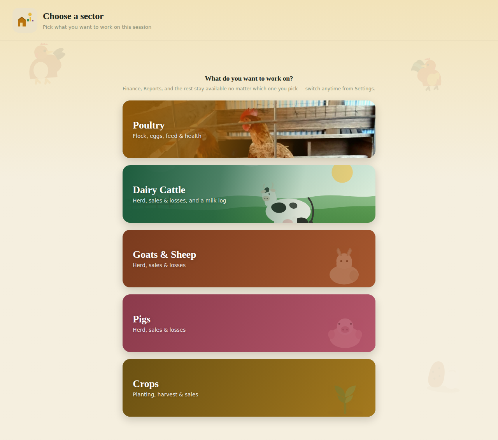
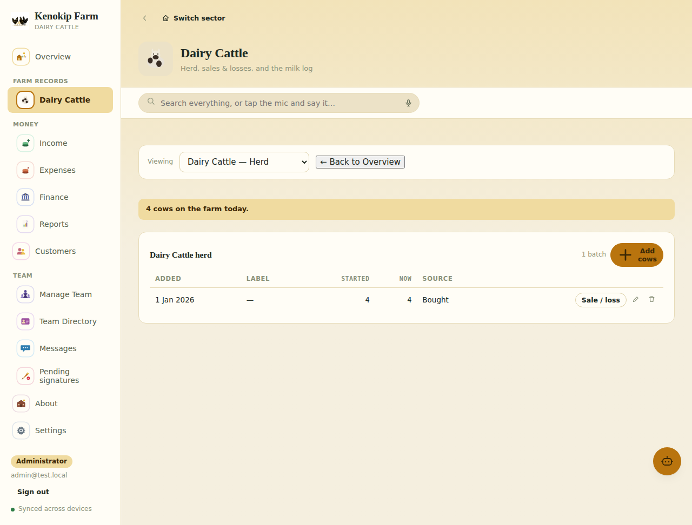

<div align="center">


# Kenokip Farm

**A farm-management app for poultry, livestock and crops — with M-Pesa built in.**

Installable on any phone or computer · Works offline · Syncs across devices

</div>

---

## Contents

- [What it does](#what-it-does)
- [Screenshots](#screenshots)
- [How it works](#how-it-works)
- [Project structure](#project-structure)
- [Getting started](#getting-started)
- [Deploying](#deploying)
- [Documentation](#documentation)
- [License](#license)

## What it does

Kenokip Farm keeps a farm's day-to-day records, money and team in one place.

| Area | Highlights |
| --- | --- |
| 📊 **Dashboard** | Whole-farm overview: animals by type, eggs today, births, sales, deaths and mortality, feed stock, upcoming care, income vs expenses chart, recent activity |
| 🐔 **Poultry** | Flock batches (hens, cocks, growers, chicks), Guinea Fowl, brooding, daily egg collection, batch profitability, poultry-house sensors |
| 🐄 **Livestock** | Dairy cattle register with breeding, calving, calf feeding and milk log; goats & sheep, pigs, rabbits, horses, ducks, turkeys, geese, plus any animal type the farm adds |
| 🩺 **Animal Health** | Vaccinations, deworming, treatments, vet visits and symptom notes for every animal, with Healthy / Needs attention / Overdue status and reminders |
| 💞 **Breeding & Reproduction** | Expected births and hatches, mating records with gestation-based due dates, births added straight to the herd |
| 🥚 **Production** | Eggs, milk and other yields with 30-day trend charts |
| 🌾 **Feed & Inventory** | Feed use per animal group, stock on hand and days left; medicines, vaccines, equipment and supplies with low-stock and expiry alerts |
| 🌱 **Crops** | Planting, harvest and sales |
| 💰 **Money** | Income, expenses, profit and loss, reports, and a Finance portal with a live balance |
| 📱 **M-Pesa** | STK Push deposits, automatic detection of Till and Paybill payments, payouts (B2C), account balance, transaction status and payment QR codes; bank payouts through IntaSend |
| 👥 **Team** | Logins with roles and permissions, approvals, messages, signed receipts, birthdays and kudos |
| 🔒 **Security** | Authenticator-app (TOTP) codes, fingerprint/Face unlock, PIN lockout and alerts |
| 🔔 **Notifications** | Push notifications even when the app is closed, plus a weekly digest |
| 🛒 **Installations** | A public order page and an admin page for selling and licensing the app to other farms |

The interface uses one nature-inspired palette (forest green, fresh green, golden yellow, warm cream, earth brown) with light and dark modes, and works on phones, tablets and desktops.

## Screenshots

<p align="center">
  
  &nbsp;
  
</p>

## How it works

```
 ┌──────────────────────────────┐        ┌──────────────────────────────┐
 │  Web app (PWA)               │        │  Firebase                    │
 │  index.html · app.js         │ ─────▶ │  Auth · Firestore · Storage  │
 │  styles.css · sw.js          │        │  Cloud Functions (functions/)│
 │  Static hosting, offline     │        └──────────────┬───────────────┘
 └──────────────────────────────┘                       │
                                                        ▼
                                  Safaricom Daraja (M-Pesa) · IntaSend
                                  Push (FCM) · SMS / email · ESP32 sensors
```

- **Frontend:** plain HTML, CSS and JavaScript, with no build step. A service worker (`sw.js`) caches the app so it opens and records data with no signal.
- **Data:** Firebase Authentication and Cloud Firestore, so records sync across every signed-in device. Access is controlled by `firestore.rules` and `storage.rules`.
- **Backend:** Firebase Cloud Functions (Node.js 20) in `functions/` hold everything that needs a secret: M-Pesa, payouts, receipt signing, push, sensors and licensing.

## Project structure

```
.
├── index.html             App entry page
├── app.js                 App logic (all pages and features)
├── styles.css             App styles
├── farm.config.js         Farm name and database id (the one file to edit for a new farm)
├── roles.js               Roles and permissions (front end)
├── sw.js                  Service worker: offline cache and push
├── manifest.webmanifest   PWA install settings
├── order.html             Public "get this app for your farm" order page
├── order-admin.html       Admin page for installation orders
├── js/                    Third-party browser libraries (QR codes)
├── icons/                 App icons and logo
├── images/                Farm photos and banners
├── videos/                Farm story video for the About page
│
├── functions/             Firebase Cloud Functions (backend) → see functions/README.md
├── hosting-stub/          Placeholder page for Firebase Hosting (serves webhook URLs only)
├── firebase.json          Firebase deploy settings
├── firestore.rules        Database security rules
├── storage.rules          File-storage security rules
│
└── docs/                  Setup and how-to guides → see docs/README.md
```

## Getting started

You need [Node.js 20](https://nodejs.org/) and the Firebase CLI.

```bash
npm install -g firebase-tools
firebase login

# Install backend dependencies
cd functions && npm install && cd ..
```

To run the web app locally, serve the root folder with any static server and open it in a browser:

```bash
npx serve .
```

The app connects to the Firebase project named in `.firebaserc`.

## Deploying

| Part | How |
| --- | --- |
| **Web app** | Upload the root folder to any static HTTPS host (GitHub Pages, Netlify, etc.). After changing `app.js`, `index.html` or `styles.css`, bump `CACHE_NAME` in `sw.js` so installed copies update. |
| **Backend** | `firebase deploy --only functions,firestore,storage,hosting` (needs the Blaze plan). Redeploy `firestore` whenever `firestore.rules` changes. Secrets are set with `firebase functions:secrets:set NAME`. See [`docs/setup/SETUP-MPESA.md`](docs/setup/SETUP-MPESA.md). |
| **A new farm** | Edit `farm.config.js` and follow [`docs/guides/HOW-TO-DEPLOY-FOR-A-NEW-FARM.md`](docs/guides/HOW-TO-DEPLOY-FOR-A-NEW-FARM.md). |

**Installing the app:** open the site in Chrome or Edge and choose **Install app** (Android: ⋮ menu → *Add to Home screen*; iPhone: Safari → Share → *Add to Home Screen*).

## Documentation

All setup and how-to guides live in [`docs/`](docs/README.md), grouped by topic: M-Pesa and payments, security and team, notifications and sensors, and running the app for other farms.

## License

Proprietary. Copyright © 2026 Kenokip Farm. All rights reserved. See [LICENSE](LICENSE).
